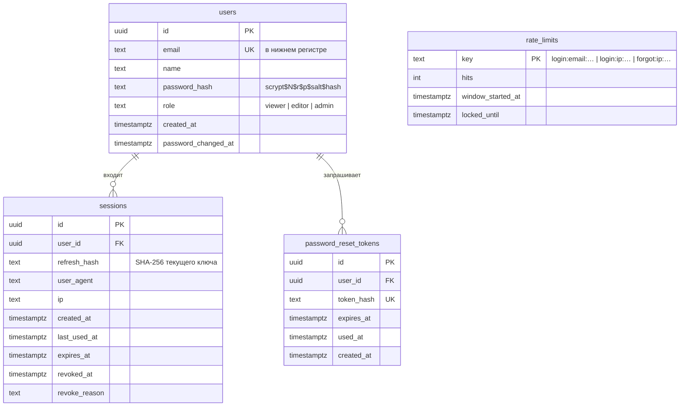
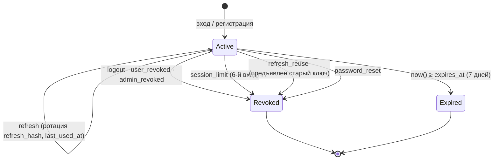

# Data Model: Модель доступа, защита учётных записей и наблюдаемость

Таблицы `tasks` и `attachments` из ЛР №2 не меняются.

## users

| Поле | Правила |
|---|---|
| `email` | 3–254 символа, формат e-mail, хранится `lower(trim())`, уникален |
| `name` | 1–100 символов после `trim` |
| `password` (вход) | 8–128 символов; хранится только `password_hash` |
| `role` | `viewer` (по умолчанию при регистрации), `editor`, `admin` |

**Иерархия ролей**: `viewer (1) < editor (2) < admin (3)`; проверка `rank(user) >= rank(required)`.

| Операция | viewer | editor | admin |
|---|:-:|:-:|:-:|
| Просмотр задач, скачивание вложений | ✅ | ✅ | ✅ |
| Создание / изменение / удаление задач и вложений | ❌ 403 | ✅ | ✅ |
| Свои сеансы: просмотр и завершение | ✅ | ✅ | ✅ |
| Пользователи: список, смена роли | ❌ 403 | ❌ 403 | ✅ |
| Сеансы всех пользователей: просмотр и завершение | ❌ 403 | ❌ 403 | ✅ |

## sessions — жизненный цикл

Активный сеанс: `revoked_at IS NULL AND expires_at > now()`. Не более 5 активных на пользователя.

## password_reset_tokens — жизненный цикл

`Issued → Used` (успешный сброс) · `Issued → Superseded` (выдан новый — `used_at = now()`) ·
`Issued → Expired` (30 минут). Использовать можно только `used_at IS NULL AND expires_at > now()`.

## rate_limits — алгоритм

При неудаче (`hit`): если окно истекло (`window_started_at < now() − 15 мин`) или блокировка
закончилась — `hits = 1`, окно начинается заново; иначе `hits + 1`. Если `hits ≥ limit` —
`locked_until = now() + 15 мин`. Проверка (`retryAfter`): `max(0, locked_until − now())` секунд.
`reset(key)` — удаление строки.

| Ключ | limit | Сброс |
|---|---|---|
| `login:email:<email>` | 5 | успешный вход, сброс пароля |
| `login:ip:<ip>` | 20 | истечение окна |
| `forgot:ip:<ip>` | 5 (каждый запрос — `hit`) | истечение окна |
